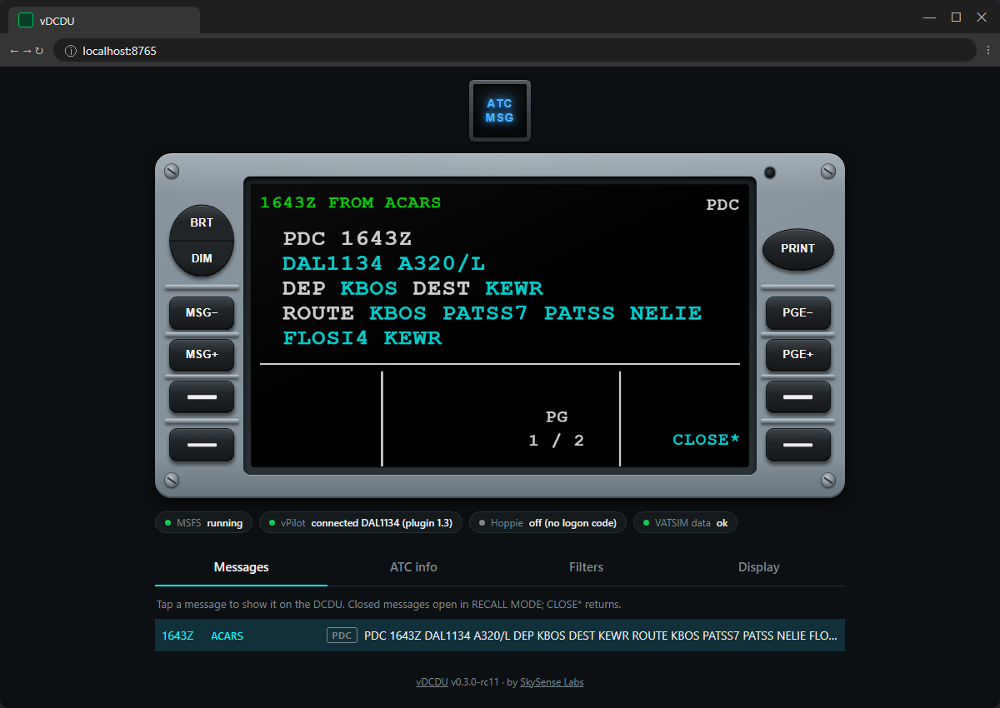

# vDCDU

**Your VATSIM datalink messages on an Airbus-style DCDU: in your browser, on a tablet, or on a display you build.**

On VATSIM, controllers send PDCs (pre-departure clearances) and private messages through vPilot. vDCDU shows them on a DCDU screen, so you don't have to alt-tab to vPilot or keep another window open. Use it with any aircraft.

## What it does

- **PDCs from vPilot**, laid out like a real airline PDC
- **Private messages, frequency text, SELCAL and ATIS**, all on the DCDU
- **Runs in a web browser**, on your sim PC or any tablet on your network
- **Works like the real DCDU:** same screen, colours and keys
- **Optional: CPDLC through Hoppie's ACARS.** Answer ATC with WILCO, UNABLE, STANDBY and more, straight from the DCDU.
- **Optional: build your own hardware DCDU** with the included firmware

## What you need

- Windows 10 or 11, and Microsoft Flight Simulator 2020 or 2024
- vPilot
- For CPDLC only: a free [Hoppie logon code](https://www.hoppie.nl/acars/system/register.html)

## Get it

Download **`vDCDU-Setup-<version>.exe`** from the [latest release](../../releases/latest) and run it. See [Installation](docs/install.md).

## Documentation

- [Installation](docs/install.md)
- [User guide](docs/user-guide.md)
- [Troubleshooting](docs/troubleshooting.md)
- [Build your own display](docs/diy-display.md)
- [Display protocol](docs/display-protocol.md), for your own display designs
- [vDCDU vs the real DCDU](docs/dcdu-reference.md)

## Licence

- **vDCDU** is free for personal use and closed source ([licence](LICENSE.md)).
- **The display firmware** (`firmware/`) is free to build and change for non-commercial use ([PolyForm Noncommercial](firmware/LICENSE.md)).

---

vDCDU is made by **[SkySense Labs](https://www.skysenselabs.com)**. For flight simulation only. Not affiliated with Airbus, Microsoft, VATSIM, vPilot or Hoppie's ACARS.
