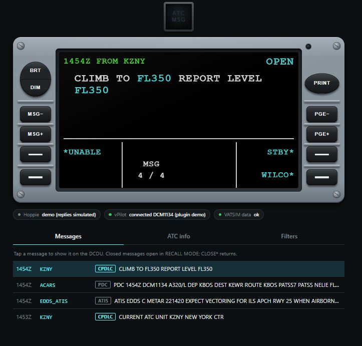

# vDCDU

**An A320-style DCDU for your home cockpit or tablet, for flying online on VATSIM.**

vDCDU shows CPDLC messages from ATC (through [Hoppie's ACARS](https://www.hoppie.nl/acars/)), US pre-departure clearances, private messages and ATIS on a DCDU that works like the real one: the same screen, colours, keys and two-step replies (choose, then SEND). Your WILCO, UNABLE, STANDBY, ROGER, AFFIRM and NEGATIVE go back to the controller.

Use it in a web browser on your sim PC or a tablet, or on a **DCDU display you build yourself**. Every screen shows the same DCDU, and a key pressed on one works on all of them.

## What you need

- A Windows 10 or 11 PC with **Microsoft Flight Simulator 2020 or 2024**
- **vPilot**, connected to VATSIM
- A free **Hoppie ACARS logon code** ([register here](https://www.hoppie.nl/acars/system/register.html)). Fenix pilots: it's the code already in your EFB.
- For CPDLC: an aircraft or program that **logs on to the ATC station** through Hoppie, such as the Fenix A320's or FlyByWire A32NX's MCDU. vDCDU shows the messages and sends your answers, but doesn't send logon requests itself (yet). PDCs, private messages and ATIS work with any aircraft.

## Download

Get **`vDCDU-Setup-<version>.exe`** from the [latest release](../../releases/latest) and run it. The [installation guide](docs/install.md) walks you through it in about five minutes.

## Documentation

| | |
|---|---|
| [Installation](docs/install.md) | Install, first start, tablets, updates |
| [User guide](docs/user-guide.md) | The screen, the keys, answering ATC, the web page |
| [Troubleshooting](docs/troubleshooting.md) | What every status means, common problems |
| [How it compares to the real DCDU](docs/dcdu-reference.md) | What works like the aircraft, what's added, what's left out |
| [Build your own display](docs/diy-display.md) | A 4.3" hardware DCDU: parts, firmware, keys, other boards |
| [Display protocol](docs/display-protocol.md) | What the program sends to a display, for your own builds |

## Build your own display

The display firmware is in [`firmware/`](firmware/) as an Arduino IDE sketch. It's ready to build for the **Guition JC4827W543C** (an ESP32-S3 board with a 4.3" 480×272 screen, sold on AliExpress), and each release also has a ready-made firmware file for that board. For other boards, screens and key wiring, see the [DIY display guide](docs/diy-display.md).

There's no ready-made display for sale. If you build one, please share it in [Discussions](../../discussions).

## Licence

- The **vDCDU program** (the installer) is free to use for personal flight simulation. It's closed source. See the licence shown during setup ([LICENSE.md](LICENSE.md)).
- The **display firmware** in `firmware/` is source-available under the [PolyForm Noncommercial License 1.0.0](firmware/LICENSE.md): build it, change it and share your changes for non-commercial use. Selling the firmware, or displays running it, isn't allowed without permission.
- The **documentation** is under [CC BY-NC 4.0](https://creativecommons.org/licenses/by-nc/4.0/).

Third-party components are listed in [THIRD_PARTY_NOTICES.md](THIRD_PARTY_NOTICES.md).

## Not for real-world use

vDCDU is for flight simulation only. It's an independent hobby project, not affiliated with or endorsed by Airbus, Fenix Simulations, FlyByWire Simulations, Microsoft, VATSIM, vPilot or Hoppie's ACARS. Their names are used only to say what vDCDU works with.

## Questions and problems

Check [Troubleshooting](docs/troubleshooting.md) first, then [open an issue](../../issues/new/choose). Never post your Hoppie logon code.
