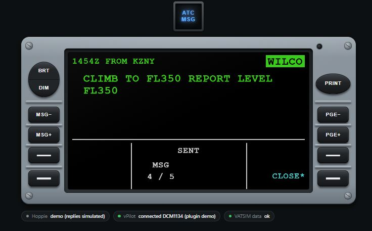
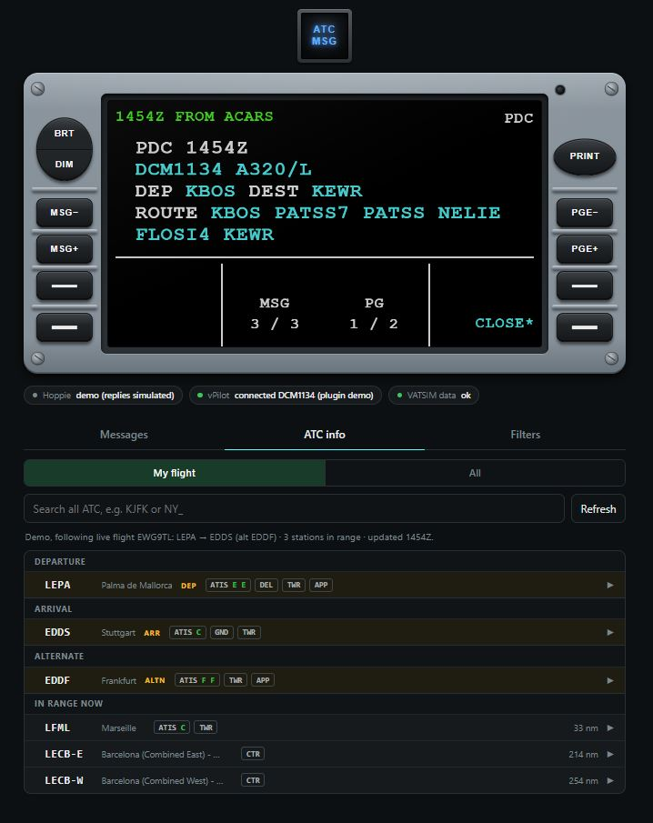

# User guide

How to read vDCDU's screen, use its keys, answer ATC, and use the web page. If it isn't installed yet, start with the [installation guide](install.md).

- [The screen](#the-screen)
- [The keys](#the-keys)
- [Answering ATC (CPDLC)](#answering-atc-cpdlc)
- [Message types](#message-types)
- [The web page](#the-web-page)
- [Demo mode](#demo-mode)
- [Good to know](#good-to-know)

---

## The screen


| Area | What it shows |
|---|---|
| **Top line, green** | Time received and sender, e.g. `1454Z FROM KZNY` |
| **Top right** | Message status: `OPEN` (cyan) = waiting for your answer. After you choose a reply it shows on a cyan box (`WILCO`), and on a green box once sent. For other messages: `PDC`, `PM`, `ATIS`, … |
| **Message text** | White. Values ATC filled in (levels, frequencies, waypoints) are **cyan**. The whole message turns **green** once you've answered. |
| **Bottom left / right** | The key prompts (cyan) for the four line keys next to them. A `*` on the key side means the prompt is active, e.g. `*UNABLE`, `WILCO*`. |
| **Bottom centre** | The status line (e.g. `SENT`, `PRIORITY MSG`, `NO MORE MSG`), `MSG 2 / 4` (which message of how many) and `PG 1 / 2` (which page). |

With nothing to show, the message area is empty, or shows `CURRENT ATC UNIT KZNY CTL` once you've logged on to a CPDLC station. `RECALL*` (bottom right) brings back the last message you closed, as on the real DCDU. In recall mode, MSG− / MSG+ step through older closed messages: that's a vDCDU addition.

**Power.** Like the real unit, the DCDU is dark while the aircraft has no power. Here that means while neither Microsoft Flight Simulator nor a vPilot connection is running on the PC. When one starts it shows `SELF TEST IN PROGRESS`, then `WAITING FOR DATA`, then the normal screen (about 20 seconds). When both have closed it stays on for 10 seconds, then goes dark. Your messages are kept.

---

## The keys

| Key | What it does |
|---|---|
| **Line keys** (two each side, bottom) | Act on the prompt next to them: `WILCO*`, `*UNABLE`, `STBY*`, `SEND*`, `*CANCEL`, `CLOSE*`, `RECALL*` |
| **MSG− / MSG+** | Previous / next message. `NO MORE MSG` at either end. |
| **PGE− / PGE+** | Previous / next page of a long message. `NO MORE PGE` at either end. |
| **PRINT** | Adds the shown message to `dcdu_print.txt` in your vDCDU files folder (Start menu → **vDCDU files**). |
| **BRT / DIM** | Brighter / dimmer. Brightness is shared by every display. |
| **ATC MSG** (above the DCDU) | Flashes blue for a new ATC message. Press it to stop the flashing. |

**CLOSE and RECALL:** `CLOSE*` removes a message from the list. With no messages open, `RECALL*` brings back the last closed one (`RECALL MODE`); then MSG− / MSG+ step through older closed messages. `CLOSE*` leaves recall mode.

---

## Answering ATC (CPDLC)

Replies are sent in two steps, as on the real aircraft: **choose**, then **SEND**.

1. A message arrives: the ATC MSG light flashes, the page chimes and the DCDU shows `OPEN`.
2. If the message has more than one page (`PG 1 / 2`), read every page with **PGE+** first. **Reply keys stay locked until you have.**
3. Press the key next to your answer, e.g. `WILCO*`. The status shows `WILCO` on a cyan box.
4. Press `SEND*` to send it, or `*CANCEL` to choose again.
5. The status turns to `WILCO` on a green box, the text turns green, and `SENT` appears. Press `CLOSE*` when you're done.

| The message asks for | Prompts |
|---|---|
| WILCO / UNABLE | `*UNABLE` (L1), `STBY*` (R1), `WILCO*` (R2) |
| AFFIRM / NEGATIVE | `*NEGATV` (L1), `AFFIRM*` (R2) |
| ROGER | `ROGER*` (R2) |
| No reply needed | `CLOSE*` (R2) |

- **STBY** (standby) is sent straight away, without SEND, and the message stays open so you can answer properly later.
- **SEND FAILED** means the reply couldn't reach Hoppie. Press `SEND*` again to retry.
- A **high-priority** message that arrives while you're answering another shows `PRIORITY MSG`. Finish the current one, then press MSG+.



---

## Message types

| Label (top right) | Comes from | Reply? |
|---|---|---|
| `OPEN` / reply status | **CPDLC** from ATC through Hoppie | Yes, as above |
| `PDC` | **US pre-departure clearance** through vTDLS. Arrives in vPilot as a private message from "ACARS", and is laid out like an airline PDC with the values in cyan. | No, read back by voice as usual |
| `PM` | A private message to you from a controller or pilot in vPilot | No |
| `RADIO` | Text typed on the frequency you're tuned to | No |
| `ATIS` / `INFO` | An ATIS, or a controller's information text | No |
| `SELCAL` | A SELCAL call to your aircraft | No |
| `BCAST` | A VATSIM supervisor broadcast | No |

Which of these appear is set on the [Filters tab](#filters). CPDLC and PDCs always appear.

---

## The web page

Below the DCDU are three small status indicators (Hoppie, vPilot, VATSIM data). Green means working; the [troubleshooting guide](troubleshooting.md#the-status-indicators) explains every status. Below them are four tabs.

### Messages
Every message of this flight, newest first. Tap one to show it on the DCDU. Closed messages open in `RECALL MODE`.

### ATC info
Lets you send any station's ATIS or controller info to the DCDU. There are two views:

- **My flight** (default): your **departure**, **arrival** and **alternate** airports from your VATSIM flight plan, with the positions online at each (e.g. `ATIS D  DEL  GND  TWR`), then **In range now**: every other station whose radio range covers your aircraft, nearest first. Centres appear and drop off as you fly.
- **All**: every station online, grouped by country (most controllers first), then by airport or sector. Shown automatically when you're not connected to VATSIM.

Tap an airport to see its frequencies, then **Show on DCDU** next to a station. The search box searches all stations worldwide, by airport code, name or callsign. The list refreshes every minute while the tab is open.



### Filters
Choose which messages appear on the DCDU:

| Setting | Options |
|---|---|
| CPDLC (Hoppie) | Always on |
| PDC | Always on |
| Private messages | On / off. Doesn't affect PDCs. |
| Frequency text | **Mentions me** (only messages containing your callsign), **All**, or **Off** |
| Auto ATIS | Your departure and arrival ATIS, again whenever the letter changes |
| SELCAL | On / off |
| Broadcasts | On / off |

Settings are saved on the PC and shared by every screen.

### Display
For a [display you've built](diy-display.md). Each display connected to vDCDU has a card:

- **Name, board and firmware version**, and whether it's connected by **USB** or **Wi-Fi**.
- **Connection:** with the display plugged into the PC by USB, switch it between **USB cable** and **Wi-Fi**, and choose its Wi-Fi network and password.
- **Keys:** the 12 DCDU keys. Keys your firmware doesn't have wired up are greyed out. Press a key on the display and it lights up here: a quick way to test your wiring.
- **Can't connect over Wi-Fi?** (only shown when needed): type this PC's address by hand, or **Forget Wi-Fi**.

**My display isn't listed** lists the USB ports on this PC. A display on an ESP32-S3's own USB port is found by itself. Many other boards use a USB-serial chip (CH340, CP210x, FTDI); tick that port once and vDCDU looks for a display there from then on.

**Look for a display on USB** turns the USB search off, for example while you upload firmware with the Arduino IDE.

---

## Demo mode

Try everything without flying, even on a PC without the sim or vPilot. Close vDCDU first if it's running (Task Manager → **DCDU** → End task), then open PowerShell and type:

```powershell
& "$env:LOCALAPPDATA\Programs\DCDU\DCDU.exe" --demo --open
```

The demo connects as callsign `DCM1134` and every 25 seconds sends one of each message type: CPDLC (including a multi-page oceanic clearance and a high-priority message), a PDC, private message, frequency text, SELCAL and a broadcast. Your replies work but are **simulated**: nothing is sent to ATC. The Filters work as normal. The ATC info tab follows a real flight that's in the air on VATSIM at that moment, so you can see the My flight view working.

Under the status indicators, **Demo** buttons pretend to start and close MSFS and to connect and disconnect vPilot, so you can watch the DCDU power up (`SELF TEST IN PROGRESS`, `WAITING FOR DATA`) and go dark. Demo messages only arrive while the pretend vPilot is connected.

---

## Good to know

- **One DCDU at a time.** The Fenix receives the same CPDLC messages as this DCDU. Answer each message on one of them only, or hide the Fenix's own DCDU in its EFB settings.
- **Hoppie isn't instant.** Hoppie's rules allow checking for new messages only every 60–90 seconds, so a CPDLC message can take up to a minute and a half to appear. For 3 minutes after you reply, it checks every 20–30 seconds. vPilot messages (PDCs, PMs) arrive instantly.
- **New flight, clean DCDU.** Connecting to VATSIM with a different callsign clears the DCDU and the message log.
- **Several screens.** The PC, any number of tablets and the hardware display all show the same DCDU. A key pressed on one acts on all.
- **Tablets:** tap the page once after opening it so the chime can play, and set the tablet's auto-lock to *Never* while flying. After a sleep, the page reconnects by itself.
