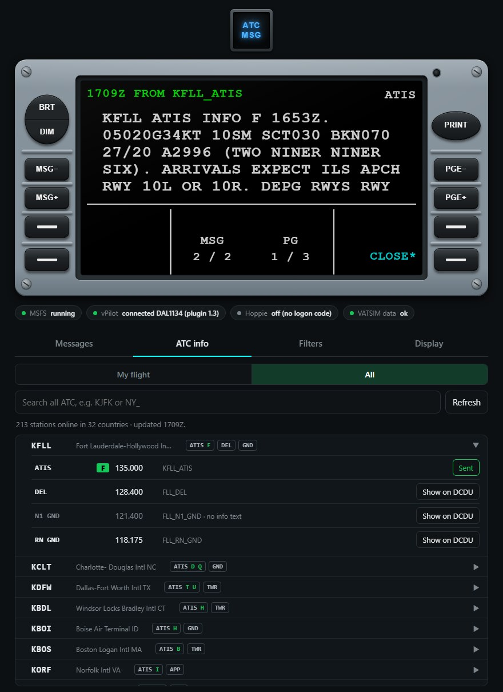

# User guide

## The screen

| Area | Shows |
|---|---|
| Top left (green) | Time and sender, e.g. `1643Z FROM ACARS` |
| Top right | Message type (`PDC`, `PM`, `ATIS`…) or, for CPDLC, its status (`OPEN` = waiting for your answer) |
| Middle | The message. Values (levels, frequencies, routes) are cyan. |
| Bottom corners | Prompts for the four line keys, e.g. `CLOSE*`, `WILCO*` |
| Bottom centre | Status line, `MSG 1 / 3`, `PG 1 / 2` |

The DCDU is dark until the sim is running or vPilot is connected, like the real one without aircraft power.

## The keys

| Key | Does |
|---|---|
| Line keys (two each side) | The prompt next to them: `CLOSE*`, `RECALL*`, `WILCO*`… |
| MSG− / MSG+ | Previous / next message |
| PGE− / PGE+ | Previous / next page |
| BRT / DIM | Brightness |
| PRINT | Saves the message to `dcdu_print.txt` (Start menu → **vDCDU files**) |
| ATC MSG (top) | Flashes for a new message. Press to stop. |

`CLOSE*` removes a message. With nothing open, `RECALL*` brings back the last one.

## Messages

| Type | From | Needs Hoppie? |
|---|---|---|
| `PDC` | Pre-departure clearance sent by ATC through vPilot | No |
| `PM` | Private message in vPilot | No |
| `RADIO` | Text on your frequency | No |
| `ATIS` / `INFO` | ATIS or controller info | No |
| `SELCAL`, `BCAST` | SELCAL call, network broadcast | No |
| CPDLC (`OPEN`) | ATC instructions you answer | **Yes** |

Choose which ones appear on the **Filters** tab.

## Answering ATC (CPDLC, needs Hoppie)

CPDLC messages come from Hoppie's ACARS and your answers go back to ATC through Hoppie. Log on to the ATC station first (with your aircraft's ACARS / MCDU, or another Hoppie client).

1. Read every page (**PGE+**). The reply keys unlock after the last page.
2. Press your answer, e.g. `WILCO*`.
3. Press `SEND*` (or `*CANCEL`).
4. Press `CLOSE*` when done.

`STBY*` is sent straight away and keeps the message open. If your aircraft also answers CPDLC through Hoppie, answer each message on one DCDU only.

## The web page tabs

- **Messages:** this flight's messages. Click one to show it.
- **ATC info:** stations online for your flight, or worldwide. **Show on DCDU** sends their ATIS or info to the DCDU.

  

- **Filters:** which messages appear.
- **Display:** your [hardware display](diy-display.md), if you have one.

## Demo mode

Try it without flying. Close vDCDU first (Task Manager → **DCDU** → End task), then in PowerShell:

```powershell
& "$env:LOCALAPPDATA\Programs\DCDU\DCDU.exe" --demo --open
```

A test message of every kind arrives every 25 seconds. Replies are simulated. The **Demo** buttons switch the pretend sim and vPilot on and off.

## Tips

- Any number of browsers, tablets and displays can show the DCDU. A key pressed on one works on all.
- Tablets: set auto-lock to *Never* while flying.
- A new callsign starts a clean DCDU.
- Hoppie checks for CPDLC every 60–90 seconds, so those can take a minute. vPilot messages are instant.
